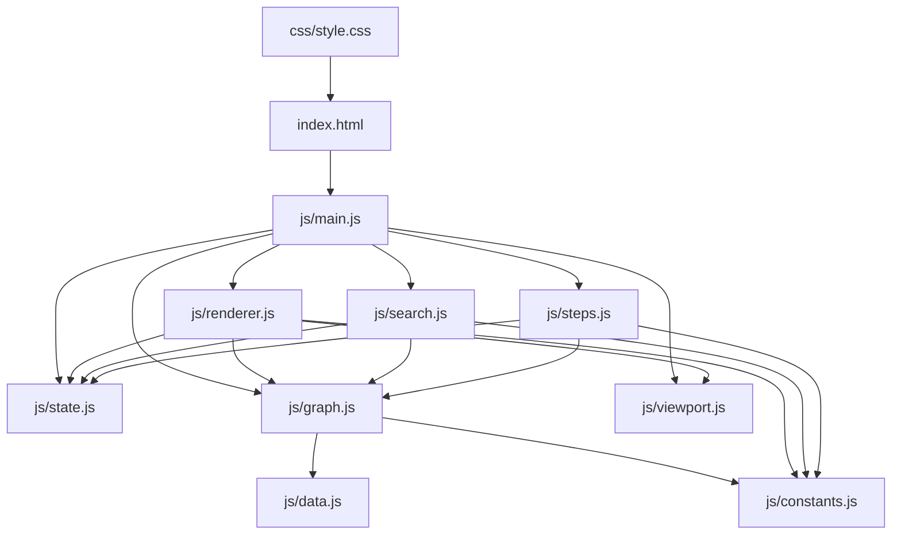

# 📁 Campus 25 Navigator — File Responsibilities & Architecture Report

This report documents the architectural role, key exports, and responsibilities of every file in the **Campus 25 Navigator** codebase.

---

## 🗺️ High-Level System Overview

---

## 📂 File-by-File Breakdown

### 1. Core Logic & Routing (`js/`)

| File | Primary Responsibility | Key Functions / Exports |
| :--- | :--- | :--- |
| [`js/graph.js`](file:///c:/Users/KIIT/Projects/Dev/Campus_25_navigator/js/graph.js) | **Graph Topology & Pathfinding** Constructs topological corridor graph per floor, calculates segment intersections, orthogonal room snapping, and executes Dijkstra shortest-path calculations. | • `PriorityQueue` (MinHeap) • `buildFloorGraph(fl)` • `dijkstra(graph, src)` • `findFloorPath(floorGraph, startId, endId)` • `findRouteLegs(startRef, endRef, preferredConn)` • `FLOORS` |
| [`js/renderer.js`](file:///c:/Users/KIIT/Projects/Dev/Campus_25_navigator/js/renderer.js) | **SVG Canvas Rendering** Renders corridor road networks, room nodes, icons, labels, animated route paths, directional chevrons, and active connector tags. | • `renderFloor(floorIdx, onSelect, onConnClick)` • `drawActiveRoute()` • `renderDirectionalArrows(points)` • `updateGuidanceBanner()` • `openNodeCard(node)` / `closeNodeCard()` |
| [`js/search.js`](file:///c:/Users/KIIT/Projects/Dev/Campus_25_navigator/js/search.js) | **Search & Guided Facility Picker** Handles fuzzy search across all 4 floors, ranking, keyboard arrow navigation, debounced input, and interactive washroom selection chip flows. | • `searchLocations(query)` • `renderSearchDropdown(...)` • `setupSearchEvents(...)` • `startWashroomFlow(...)` • `debounce(fn, ms)` |
| [`js/steps.js`](file:///c:/Users/KIIT/Projects/Dev/Campus_25_navigator/js/steps.js) | **Turn-by-Turn Navigation** Analyzes polyline vectors using 2D cross-products to generate turn directions (straight, left, right), distance estimates, walk time, and manages active step progression with auto-scrolling. | • `simplifyPathPolyline(points)` • `generateStepList(routeResult, start, dest)` • `navigateToStep(stepIdx, updateFloor, drawRoute)` |
| [`js/state.js`](file:///c:/Users/KIIT/Projects/Dev/Campus_25_navigator/js/state.js) | **Central State Store & URL Sync** Maintains application state, recent destinations in `localStorage`, non-overlapping stacked toast notifications, and URL deep-link serialization/deserialization. | • `state` (reactive object) • `showToast(message)` • `saveRecent(ref)` • `formatPointName(ref)` • `generateShareUrl()` / `syncHistoryUrl()` |
| [`js/viewport.js`](file:///c:/Users/KIIT/Projects/Dev/Campus_25_navigator/js/viewport.js) | **Pan, Zoom & Viewport Gestures** Controls SVG `viewBox`, multi-touch pinch-to-zoom, mouse wheel zooming, pan drag tolerances, and automatic camera fitting around calculated route bounds. | • `viewBox` • `applyViewBox()` • `fitViewport()` • `zoomViewport(factor, cx, cy)` • `zoomToRoute(points)` • `setupViewportEvents()` |
| [`js/constants.js`](file:///c:/Users/KIIT/Projects/Dev/Campus_25_navigator/js/constants.js) | **Design Tokens & Lookup Dictionaries** Defines DOM selector helper `$()`, room type descriptions, floor names/codes, SVG namespace, and color mapping tables. | • `$` (DOM helper) • `COLORS` • `ICONS` • `ROOM_TYPES` • `FLOOR_NAMES` / `FLOOR_CODES` |
| [`js/data.js`](file:///c:/Users/KIIT/Projects/Dev/Campus_25_navigator/js/data.js) | **Raw Coordinates & Geometry Dataset** Stores base campus node coordinate data (`D`) and corridor polyline sequences (`L`). | • `D` (compact node CSV string) • `L` (corridor polyline coordinate arrays) |
| [`js/main.js`](file:///c:/Users/KIIT/Projects/Dev/Campus_25_navigator/js/main.js) | **Application Entry & Event Orchestration** Bootstraps the application, wires UI buttons, handles global keyboard shortcuts (`1-4`, `Enter`, `Escape`), manages QR share modal, and registers the service worker. | • `initializeApp()` • `calculateRoute()` • `setLocationReference(ref)` • `refreshUI()` |

---

### 2. User Interface & Presentation

| File | Primary Responsibility |
| :--- | :--- |
| [`index.html`](file:///c:/Users/KIIT/Projects/Dev/Campus_25_navigator/index.html) | **HTML5 Semantic Shell & SVG Viewport** Defines the DOM structure, SVG canvas elements (`#roads`, `#nodes`, `#route`, `#arrows`, `#cur`), side panel, search inputs, step card, node details card, floor dropdown menu, and modal dialogs. |
| [`css/style.css`](file:///c:/Users/KIIT/Projects/Dev/Campus_25_navigator/css/style.css) | **Stylesheet & Visual Design System** Custom dark theme, CSS custom properties, glassmorphism panel styles, route polyline dash-offset animations, responsive mobile bottom-drawer styles, and interactive focus states. |

---

### 3. Progressive Web App (PWA) & Public Assets (`public/`)

| File | Primary Responsibility |
| :--- | :--- |
| [`public/sw.js`](file:///c:/Users/KIIT/Projects/Dev/Campus_25_navigator/public/sw.js) | **Service Worker** Caches application shell, HTML, CSS, JavaScript chunks, and SVG assets for instant offline functionality. |
| [`public/qrcode.js`](file:///c:/Users/KIIT/Projects/Dev/Campus_25_navigator/public/qrcode.js) | **Offline QR Code Generator** Standalone client-side library generating scalable SVG QR codes for instant route sharing without third-party network requests. |
| [`public/icon.svg`](file:///c:/Users/KIIT/Projects/Dev/Campus_25_navigator/public/icon.svg) | **App Icon** Vector SVG icon used for browser tab favicon and mobile PWA home screen icon. |
| [`manifest.webmanifest`](file:///c:/Users/KIIT/Projects/Dev/Campus_25_navigator/manifest.webmanifest) | **Web App Manifest** Configures PWA installation parameters (name, theme colors, display mode `standalone`, and icon sizes). |

---

### 4. Build, Configuration & Documentation

| File | Primary Responsibility |
| :--- | :--- |
| [`vite.config.js`](file:///c:/Users/KIIT/Projects/Dev/Campus_25_navigator/vite.config.js) | **Vite Bundler Configuration** Configures build optimizations, base path, public directory serving, and development server. |
| [`vercel.json`](file:///c:/Users/KIIT/Projects/Dev/Campus_25_navigator/vercel.json) | **Deployment & CDN Caching Rules** Configures Vercel routing rewrites for SPA history API, immutable static asset cache headers, and service worker no-cache policy. |
| [`package.json`](file:///c:/Users/KIIT/Projects/Dev/Campus_25_navigator/package.json) | **Project Manifest & Scripts** Defines project dependencies (`vite`), scripts (`npm run dev`, `npm run build`, `npm run preview`). |
| [`README.md`](file:///c:/Users/KIIT/Projects/Dev/Campus_25_navigator/README.md) | **Project Documentation** Comprehensive developer and user documentation including feature overview, keyboard shortcuts, installation, and deployment guides. |
| [`FILE_REPORT.md`](file:///c:/Users/KIIT/Projects/Dev/Campus_25_navigator/FILE_REPORT.md) | **Architecture & File Responsibility Reference** This reference document detailing module relationships and file responsibilities. |

---

## 🔄 Interaction Data Flow

1. **User selects a start & destination**:
   - Via search ([`search.js`](file:///c:/Users/KIIT/Projects/Dev/Campus_25_navigator/js/search.js)), clicking canvas room nodes ([`renderer.js`](file:///c:/Users/KIIT/Projects/Dev/Campus_25_navigator/js/renderer.js)), or quick navigation amenity buttons ([`main.js`](file:///c:/Users/KIIT/Projects/Dev/Campus_25_navigator/js/main.js)).
2. **State updates & triggers route calculation**:
   - Stored in [`state.js`](file:///c:/Users/KIIT/Projects/Dev/Campus_25_navigator/js/state.js), URL updated, and [`calculateRoute()`](file:///c:/Users/KIIT/Projects/Dev/Campus_25_navigator/js/main.js#L91) called.
3. **Shortest path computed**:
   - [`graph.js`](file:///c:/Users/KIIT/Projects/Dev/Campus_25_navigator/js/graph.js) runs MinHeap Dijkstra (`dijkstra`) and multi-floor connector search (`findRouteLegs`).
4. **Directions & Canvas updated**:
   - [`steps.js`](file:///c:/Users/KIIT/Projects/Dev/Campus_25_navigator/js/steps.js) parses turn vectors into instructions.
   - [`renderer.js`](file:///c:/Users/KIIT/Projects/Dev/Campus_25_navigator/js/renderer.js) draws animated path polyline (`#route`) and directional chevrons (`#arrows`).
   - [`viewport.js`](file:///c:/Users/KIIT/Projects/Dev/Campus_25_navigator/js/viewport.js) auto-fits camera bounds (`zoomToRoute`).
